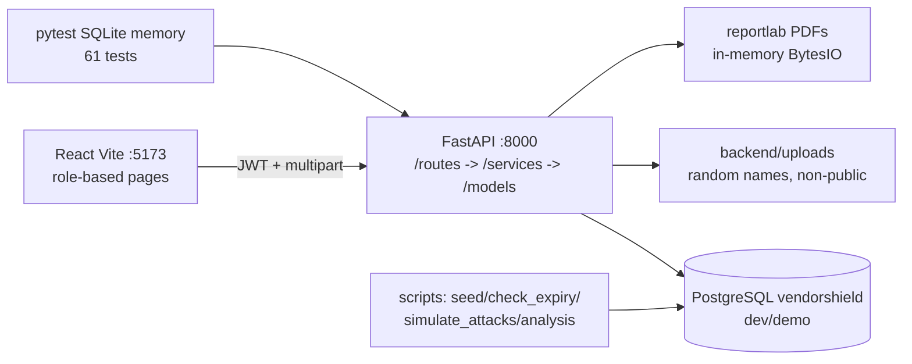

# Architecture

## Diagram

## Data flow
1. Login -> bcrypt verify -> JWT access (15min) + refresh (7d, jti rotation); Admin TOTP enforced.
2. Routes validate (Pydantic) -> `require_roles`/scoping -> services (scoring/lifecycle/detection/reporting) -> SQLAlchemy ORM -> Postgres.
3. Every create/update/delete/login writes `audit_logs` (append-only) + SOC `security_events` where relevant.
4. Detection runs on demand over events -> alerts (deduped) -> triage -> incidents (stepwise + notes).
5. Dashboard/PDFs aggregate live tables; pandas script reads SQL offline into `backend/reports/`.

## Security design (see SECURITY.md + VAPT_REPORT.md)
- Least privilege per endpoint; Vendor ID-scoped; Auditor read-only; SoD (2nd Admin).
- Pydantic + ORM-only (no raw SQL); ext/MIME/header upload checks; 10MB; random names.
- Strict CORS, security headers, login rate limit 5/5min/IP, bcrypt, JWT exp+rotation, `.env` secrets.
- Known gaps (honest): localStorage JWT, no prod TLS, manual perm-denied feeding, assessments lack `created_at`, braces accepted dev-only.
